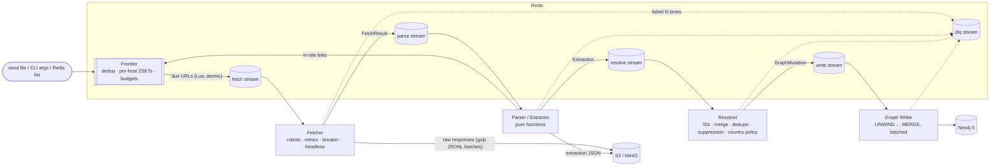

# LeadGraph

A staged web crawler and data pipeline that discovers B2B company data on
public websites and stores it as a property graph: companies, domains, people,
emails, phones, social profiles, technologies, locations and pages, with
provenance and a confidence on every fact. The raw responses are kept, so the
graph can be rebuilt.

It is built to be a well-behaved crawler: it obeys robots.txt and
`noindex`/`nofollow`, identifies itself, rate-limits per host and globally, has
a kill switch, a suppression list, and an erase command that removes a person
from every store.

## Architecture



Each stage is a subcommand of one binary and scales independently. Stages are
connected by Redis Streams with one consumer group each.

| Property | How it is achieved |
|---|---|
| At-least-once delivery | A message is acknowledged only after its result is durable downstream (the writer acks after the Neo4j commit). An unacknowledged message is taken over by any consumer after `queue.claim_min_idle`. |
| No duplicates | Every consumer is idempotent: URL dedup in the frontier, content-hash check in the parser, deterministic IDs in the resolver, `MERGE` with a confidence rule in the writer. |
| Dead letters | After `queue.max_deliveries` attempts a message moves to the `dlq` stream with its error. `leadgraph dlq replay` puts it back. |
| Backpressure | Streams are bounded by making producers wait at `queue.max_len` (never by trimming, which would drop work). Fetchers also pause when the parse backlog exceeds `fetch.parse_lag_threshold`. |
| Politeness | A host is leased from dispatch until the fetcher releases it with `finish time + delay`, so a host never has two requests in flight and `Crawl-delay` is honoured. |
| Graceful shutdown | On SIGTERM a stage stops reading, lets in-flight handlers finish and acknowledge (up to `queue.drain_timeout`), and flushes the open raw batch. |

More detail on the design choices is in [PLAN.md](PLAN.md).

## Quickstart

Requirements: Go 1.26+, Docker.

```sh
make up                           # redis, neo4j, minio, prometheus, grafana
cp seeds.example.txt seeds.txt    # one domain per line
make run SEEDS=seeds.txt          # every stage in one process
```

`make up` creates `.env` from `.env.example` on first run; change the
passwords in it. Then:

| What | Where |
|---|---|
| Neo4j browser | http://localhost:7474 (user `neo4j`, password from `.env`) |
| Grafana dashboard | http://localhost:3000 (LeadGraph → *LeadGraph pipeline*) |
| Prometheus | http://localhost:9090 |
| MinIO console | http://localhost:9001 |
| Crawler metrics | http://localhost:9108/metrics |

```sh
make stats        # frontier, stream and graph counts
make demo         # crawl the bundled fixture sites and print example queries
```

Before pointing it at real sites, set `LEADGRAPH_FETCH_CONTACT_URL` (in `.env`)
to a page that says who runs the crawler. It is sent in the User-Agent:
`LeadGraphBot/1.0 (+https://your.site/bot)`.

### Running stages separately

```sh
leadgraph migrate                 # constraints and indexes (also run by writers on start)
leadgraph seed --file seeds.txt   # or: leadgraph seed example.com other.com
leadgraph fetch                   # fetch workers + a frontier dispatcher
leadgraph parse
leadgraph resolve
leadgraph write
```

`leadgraph seed --queue …` pushes seeds onto the Redis list `<prefix>:seeds`
instead, which any running dispatcher consumes; other systems can `RPUSH` to
that list directly.

## Commands

| Command | Purpose |
|---|---|
| `seed [domain…] [-f file] [--queue]` | Add seeds |
| `frontier` | Dispatcher only (URLs → fetch stream) |
| `fetch [--dispatch=false]` | Fetch workers |
| `parse`, `resolve`, `write` | The other stages |
| `run-all [-s file] [--exit-when-idle]` | Every stage in one process |
| `migrate` | Create constraints and indexes |
| `dlq list \| replay [--stream s] [--limit n] \| purge` | Dead-letter stream |
| `suppress add\|remove --email\|--person-id\|--domain`, `suppress list`, `suppress sync` | Suppression list |
| `erase --email X [--no-cascade]`, `erase --person-id X` | Remove a data subject everywhere |
| `kill on [--reason r] \| off \| status` | Kill switch for all fetching |
| `stats [--no-graph]` | Counts |
| `rebuild [--prefix p]` | Re-parse stored raw pages to regenerate the graph |
| `config` | Validate and print the effective configuration (secrets redacted) |

## Configuration

Configuration is defaults → YAML file (`--config` or `LEADGRAPH_CONFIG`) →
environment variables, validated at startup; all problems are reported at
once and unknown YAML keys are an error. Every key can be set as
`LEADGRAPH_<SECTION>_<KEY>` (`LEADGRAPH_CRAWL_MAX_DEPTH=2`,
`LEADGRAPH_FETCH_HEADLESS_ENABLED=true`). Lists are comma-separated, maps are
`k=v,k=v`. [`config.example.yaml`](config.example.yaml) lists every key with
its default; the most important ones:

| Key | Default | Meaning |
|---|---|---|
| `crawl.max_depth` | 3 | Link depth from the seed |
| `crawl.max_pages_per_domain` | 40 | Page budget per registrable domain |
| `crawl.default_delay` | 1s | Minimum gap between requests to one host |
| `crawl.max_crawl_delay` | 30s | Cap on a robots.txt `Crawl-delay` |
| `crawl.global_rps` | 50 | Dispatch rate across all processes |
| `crawl.epoch` | `1` | Change to recrawl everything |
| `fetch.contact_url` | `https://example.com/bot` | Advertised in the User-Agent |
| `fetch.workers` | 32 | Concurrent fetches per process |
| `fetch.max_body_bytes` | 5 MiB | Larger bodies are truncated |
| `fetch.max_redirects` | 5 | Redirects must stay on the registrable domain |
| `fetch.max_retries` | 3 | In-request retries on 429/5xx/network errors |
| `fetch.robots_ttl` | 24h | robots.txt cache lifetime |
| `fetch.breaker_failures` / `breaker_cooldown` | 5 / 1m | Per-host circuit breaker |
| `fetch.headless.enabled` | false | Render JavaScript-only pages with Chrome |
| `fetch.proxies` | – | Optional proxy list (round-robin) |
| `fetch.allow_private_networks` | false | Allow loopback/private destinations |
| `resolve.countries.allow` / `deny` | – | ISO codes; denied companies are purged |
| `resolve.person_similarity` | 0.94 | Jaro-Winkler threshold for merging people |
| `graph.batch_rows` | 1000 | Rows per Neo4j transaction |
| `queue.max_len` | 10000 | Stream backlog at which producers block |
| `queue.claim_min_idle` | 5m | Idle time before unacknowledged work is taken over |
| `queue.max_deliveries` | 5 | Attempts before the DLQ |
| `telemetry.metrics_addr` | `:9108` | `/metrics`, `/healthz`, `/readyz` |
| `telemetry.otlp_endpoint` | – | OTLP/HTTP endpoint for traces |

To use hosted services instead of the local containers, set
`LEADGRAPH_NEO4J_URI` (e.g. `neo4j+s://…` for Aura) with
`LEADGRAPH_NEO4J_USERNAME`/`PASSWORD`, and `LEADGRAPH_REDIS_ADDR` with
`LEADGRAPH_REDIS_USERNAME`/`PASSWORD` and `LEADGRAPH_REDIS_TLS=true`. Redis
must allow Lua scripts and Streams; a hosted Redis without the Bloom module
works (a plain set is used for dedup).

Secrets have no defaults: `LEADGRAPH_NEO4J_PASSWORD`,
`LEADGRAPH_S3_ACCESS_KEY`, `LEADGRAPH_S3_SECRET_KEY`, and
`LEADGRAPH_REDIS_PASSWORD` if your Redis needs one.

## What is extracted

All extraction is pure code in [`internal/extract`](internal/extract): no I/O,
no clock. Every fact carries `{value, source_url, extractor, confidence,
extracted_at}`.

| Data | Sources |
|---|---|
| Company name, description, founding year, size, industry | JSON-LD `Organization`/`LocalBusiness`, OpenGraph and meta tags, `<title>`, copyright line, text patterns, keyword scoring |
| Emails | `mailto:`, visible text, de-obfuscation (`name [at] domain dot com`), Cloudflare `data-cfemail`; classified `role`/`personal`; disposable domains flagged; placeholders and asset filenames rejected. Addresses are never guessed. |
| Phones | `tel:`, JSON-LD, visible text near a phone keyword or with `+`; normalized to E.164 with the region from config or ccTLD |
| Social profiles | LinkedIn (company/person), X, Facebook, Instagram, GitHub, YouTube; canonicalized; share/intent links rejected |
| Addresses | JSON-LD `PostalAddress`, schema.org microdata, `<address>` blocks (US, CA, UK and `postal city` layouts) |
| People | JSON-LD `Person`/founder/employee, team cards, heading + role line, table rows, `Name – Title` lines; testimonials excluded |
| Technologies | ~60 fingerprints in [`rules/tech.yaml`](internal/extract/rules/tech.yaml) over script/link URLs, meta tags, headers and markup; replaceable with `extract.tech_rules_file` |
| Page type | `home`, `about`, `team`, `contact`, `careers`, `other` |

The graph schema and example queries are in
[docs/graph-schema.md](docs/graph-schema.md).

## Compliance and safety

These are built in and on by default.

- **robots.txt** is fetched once per origin, cached for 24h in Redis and
  obeyed, including for redirect targets. A disallowed URL is recorded as a
  `Page` with `skip_reason = robots_disallowed` and never requested. If
  robots.txt cannot be read (5xx, 429, network error) nothing on that host is
  fetched until it can.
- **`noindex`** (meta or `X-Robots-Tag`): the page is recorded, no facts are
  taken from it. **`nofollow`** (meta or `rel`): links are not followed.
- **Identification**: every request carries
  `LeadGraphBot/<version> (+<contact url>)`; startup fails without a contact URL.
- **Rate limits**: one request at a time per host with a configurable delay,
  `Crawl-delay` honoured up to a cap; a global requests-per-second limit
  enforced in Redis across all processes; `Retry-After` honoured; a per-host
  circuit breaker backs off from failing sites.
- **Kill switch**: `leadgraph kill on` stops dispatching immediately and every
  fetcher within half a second; URLs in flight are handed back untouched.
- **No evasion**: the crawler does not log in, submit forms, solve CAPTCHAs,
  rotate identities to dodge blocks, or fetch beyond a redirect off the site.
  The optional headless browser only loads and reads a page.
- **Private networks** are refused at the socket level (after DNS), so a
  hostile link cannot make the crawler probe internal services.
- **Suppression list**: emails and people (stored as hashes) and domains.
  Checked by the frontier and fetcher (domains), the resolver and the writer.
  `leadgraph suppress add` also removes anything already stored.
- **Erasure**: `leadgraph erase --email X` / `--person-id X` removes the node,
  its relationships, the contact nodes only that person owned, the raw record
  and extraction objects of every page that mentioned them, and suppresses
  them so a recrawl cannot bring them back.
- **Country policy**: `resolve.countries.allow` / `deny`. A company found to
  be in a disallowed country is purged and its domain is no longer crawled.

Collecting business contact data is regulated (GDPR, ePrivacy, CAN-SPAM, CCPA
and others). This software gives you the controls; choosing lawful targets and
a lawful basis, and honouring requests from data subjects, is the operator's
responsibility.

## Observability

- **Metrics** (Prometheus, `:9108/metrics`): fetch rate by outcome, HTTP status
  codes, fetch latency, robots-blocked count, breaker openings, parse outcomes
  and errors, entities extracted per type, resolver merges, suppressed and
  country-dropped counts, graph write latency, rows and retries, stream lag
  per stage, DLQ size, kill-switch state.
- **Dashboard**: [`deploy/grafana/dashboards/leadgraph.json`](deploy/grafana/dashboards/leadgraph.json),
  provisioned automatically by `make up`.
- **Tracing** (OpenTelemetry, OTLP/HTTP): set `telemetry.otlp_endpoint`. Trace
  context travels inside stream messages, so one trace follows a URL through
  fetch → parse → resolve → write.
- **Logs**: structured `slog`, JSON by default.

## Scaling notes

- **Stages scale independently.** Run more `fetch` processes for throughput,
  more `parse` for CPU; `resolve` and `write` are rarely the bottleneck. Watch
  the *Stream lag* panel: the stage whose input stream grows needs more workers.
- **Fetch throughput is bounded by politeness, not CPU.** With a 1s delay a
  host yields one page per second, so throughput ≈ number of distinct hosts in
  the frontier, capped by `crawl.global_rps` and `fetch.workers × processes`.
- **Dispatchers** are safe to run several of (the dispatch script is atomic),
  but one is enough; run `fetch --dispatch=false` on extra fetch nodes.
- **Writer**: one writer usually suffices. Several can run in parallel; rows are
  written in a fixed label order and sorted by key so they take locks in the
  same order, and deadlocks that still happen are retried.
- **Redis memory**: the frontier holds at most `max_queue_per_host` URLs per
  host; streams are capped by `queue.max_len`. The dedup filter needs
  RedisBloom (bundled with Redis 8); without it a plain set is used, which
  costs about 70 bytes per URL.
- **Redis Cluster** is not supported: the dispatch script builds key names
  from host names. Use a single primary with replicas.
- **Circuit breakers and the robots parse cache are per process**; the robots
  responses themselves are shared through Redis.
- **Raw store** objects are immutable except for erasure tombstones; lifecycle
  rules on the `raw/` and `extract/` prefixes control retention.

## Development

```sh
make test               # unit + in-memory end-to-end tests, race detector, no Docker
make test-integration   # the same scenarios against real Redis, Neo4j, MinIO (testcontainers)
make bench              # parser and graph-writer benchmarks
make fuzz               # URL normalizer and HTML extractor fuzzing
make lint               # golangci-lint (go vet + gofmt if not installed)
make image              # multi-stage, distroless, non-root image
```

Test layout:

| Where | What |
|---|---|
| `internal/extract` | Table-driven extractor tests on HTML fixtures (JSON-LD, messy team page, German imprint, obfuscated emails), adversarial-input timing, fuzz target, benchmark |
| `internal/urlx`, `internal/normalize` | URL normalization (+ fuzz), name normalization, Jaro-Winkler |
| `internal/robots`, `internal/fetch` | robots semantics; HTTP client against `httptest` servers (redirects, slow host, 429, compression, charsets, private-address guard); circuit breaker |
| `internal/queue`, `internal/frontier` | Streams semantics and frontier scheduling against miniredis |
| `internal/resolve`, `internal/graph` | IDs, merge rules, person dedupe, suppression, country policy; Cypher generation; in-memory sink; erasure |
| `internal/pipeline` | Full pipeline over the fixture sites with in-memory stores: crawl assertions, recrawl idempotence, **parser killed mid-batch**, erasure, kill switch, backpressure, DLQ replay |
| `internal/integration` (`-tags integration`) | The same pipeline against containers, asserted with Cypher; migrations; merge rules in real Cypher; chaos; erasure in MinIO; writer benchmark |

## Layout

```
cmd/leadgraph        CLI
cmd/fixturesite      local fixture web server for the demo
pkg/model            wire types and the graph schema table
internal/config      YAML + env configuration
internal/urlx        URL normalization
internal/normalize   names, countries, seniority, Jaro-Winkler
internal/extract     pure extractors + technology rules
internal/robots      robots.txt
internal/fetch       HTTP client, breaker, proxy pool, headless, fetch stage
internal/frontier    dedup, politeness, budgets, dispatcher, kill switch
internal/queue       Redis Streams consumer groups, retry, DLQ, backpressure
internal/store       S3/MinIO blob store, raw batch format, tombstones
internal/parse       parse stage, sitemaps
internal/resolve     entity resolution stage
internal/graph       Cypher, Neo4j sink, in-memory sink, migrations, writer stage
internal/suppress    suppression list
internal/erase       erasure across all stores
internal/dlq         dead-letter tooling
internal/metrics     Prometheus metrics
internal/obs         logging and tracing setup
internal/pipeline    stage wiring; shared end-to-end test harness
internal/testsite    fixture websites
deploy/              Prometheus and Grafana provisioning
```
